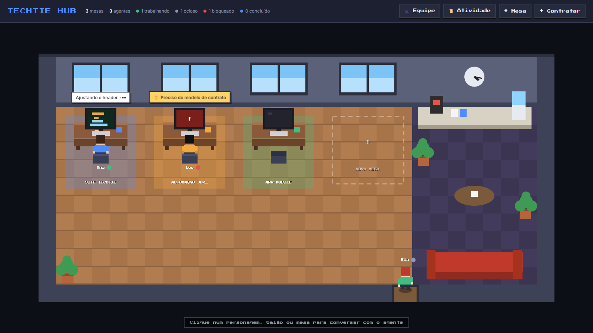
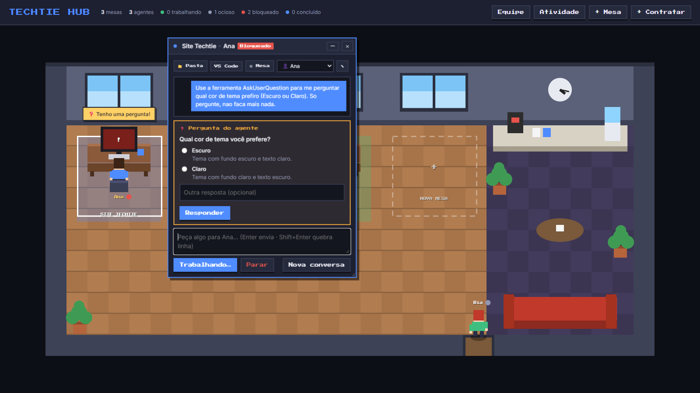
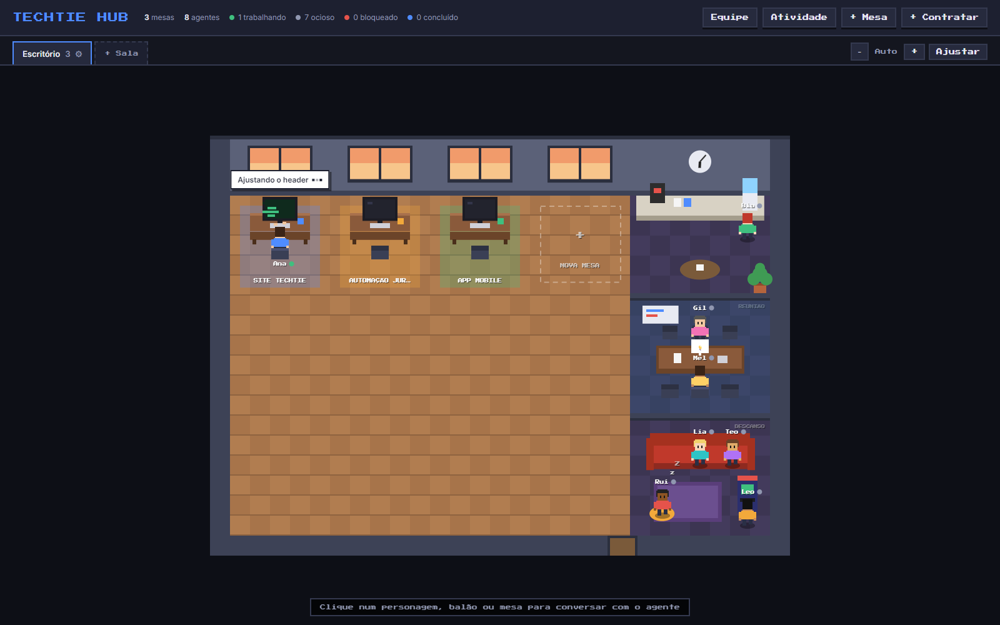

# Techtie Hub

Um escritório em pixel art, estilo game, onde **cada mesa é um projeto** e **cada personagem é um agente de IA** (Claude) trabalhando nele.

Você vê de relance quem está trabalhando, quem terminou e quem precisa de você. Também pode conversar com cada agente, responder às perguntas dele e aprovar ou negar ações direto do escritório, sem abrir o VS Code.







---

## Recursos

- **Salas.** Organize as mesas em salas, por exemplo uma por cliente ou time. Cada sala tem o próprio formato (de 2 a 8 mesas por fileira) e o próprio piso, e a aba da sala avisa quando algum agente de lá precisa de você.
- **Áreas especiais.** Cada sala tem uma coluna lateral com **copa**, **sala de reunião** e **área de descanso** (você escolhe quais). Os agentes ociosos circulam entre elas: tomam café, "conversam" em reunião, sentam no sofá, cochilam no puff e jogam fliperama.
- **Zoom e navegação.** Use os botões ou Ctrl + roda do mouse para dar zoom, e arraste o escritório com o mouse quando ele for maior que a tela.
- **Escritório animado.** Os personagens andam pelo escritório. Sentam e digitam na mesa quando trabalham, vão tomar café no lounge quando estão ociosos, e o monitor de cada mesa mostra o status. As janelas mudam de cor conforme a hora do dia e o relógio da parede marca a hora real.
- **Balões de fala** sobre cada personagem. Mostram o que o agente está fazendo, ou piscam em amarelo quando ele tem uma pergunta ou precisa de permissão.
- **Janelas flutuantes de conversa.** Clique no balão, no personagem ou na mesa para abrir. As janelas podem ser arrastadas, redimensionadas e minimizadas, e dá para abrir várias ao mesmo tempo.
- **Agentes de verdade.** O hub roda o Claude (via [Claude Agent SDK](https://code.claude.com/docs/en/agent-sdk)) na pasta de cada projeto, usando o seu login do Claude Code. As conversas continuam de onde pararam.
- **Permissões e perguntas no hub.** Quando o agente quer rodar um comando ou editar um arquivo, aparece um cartão com **Permitir / Sempre permitir / Negar**. Quando ele faz uma pergunta de múltipla escolha, as opções aparecem para você clicar.
- **Secretária.** Marque uma mesa como **secretária** (⚙ Mesa) e ela passa a receber a memória do escritório, a lista de mesas e os relatórios do dia. Ela pode **passar demandas** para as outras mesas: *"chegou uma mensagem no Bitrix sobre o BI, passe para o Leo"*. Ela acha a mesa certa pelo nome do projeto ou do agente e escreve o pedido completo. O agente da mesa começa a trabalhar, ou a demanda entra na **fila** se a mesa estiver ocupada, e você acompanha e responde no chat daquela mesa.
- **Memória do escritório.** Notas gerais e um bloco por projeto (**🧠 Memória → 🏢 Enviar para o escritório**), num lugar só (botão **Memória**).
- **Relatório do dia.** **📋 Relatório** na mesa: o agente resume o que foi feito hoje e envia para a secretária.
- **Agentes que sabem que estão no escritório.** Todo agente sabe quem ele é, qual mesa cuida, quem é a secretária e quais são as outras mesas. Também tem ferramentas do escritório: dá para pedir no chat *"manda o relatório de hoje pra secretária"*, *"avisa a secretária que terminei"* ou *"salva a memória do projeto"*. Os recados aparecem para a secretária no próximo pedido dela e em **Memória → Recados**.
- **Servidores MCP no hub.** Cadastre MCPs (Bitrix, bancos, APIs…) uma vez no botão **MCP**, ou importe os que o Claude Code do PC já conhece, e eles funcionam para os agentes em **qualquer PC conectado**. Escolha em quais mesas cada um vale, e teste a conexão sem gastar uso do plano. URLs, tokens e variáveis ficam criptografados.
- **Barra de limite de uso.** No topo, mostra a conta Claude do PC em uso e a porcentagem consumida da sessão (5h) e da semana, como a tela "Account & Usage" do Claude Code, atualizada em tempo real enquanto os agentes trabalham.
- **Compacta a conversa quando você quiser.** O botão 🧹 da caixa de conversa guarda o essencial na memória do projeto (incremental) e começa uma sessão limpa, para a cota de uso do seu plano não esgotar com conversas que só crescem.
- **Variáveis do escritório.** Webhooks, credenciais de banco, chaves de API (botão **Variáveis**). Ficam criptografadas no hub e chegam aos agentes como variáveis de ambiente em qualquer PC (`$BITRIX_WEBHOOK`, `process.env.PG_URL`). O agente sabe quais existem, mas os valores não aparecem no chat. Nos MCPs, use `${NOME}` na URL, nos cabeçalhos ou nas variáveis.
- **Use de qualquer lugar, até pelo celular.** Cada pedido roda no PC que tem a pasta da mesa. Do celular (ou de outro computador) você conversa com a mesa e o trabalho acontece no PC do escritório, desde que ele esteja ligado com o conector aberto. No celular, as janelas ocupam a tela inteira, e dá para usar **Adicionar à tela inicial** para abrir como app.
- **Contas.** Login com e-mail e senha; cada conta tem o seu próprio escritório, isolado dos outros. Novas contas só entram com convite.
- **Hub e conectores.** O hub guarda tudo; um conector em cada PC roda os agentes com as pastas e o login do Claude daquele computador. Cada PC tem a sua pasta para cada mesa, e o agente **continua a mesma conversa** em qualquer PC conectado. Se a sessão completa não estiver disponível, ele recebe a **memória** do projeto. O hub também avisa quando falta `git pull`.
- **Integração com o Claude Code do VS Code (opcional).** Por hooks, sessões abertas no VS Code dentro da pasta de uma mesa também atualizam o escritório.
- **API simples** para qualquer script ou agente reportar status.
- **Roda só na sua máquina.** Sem banco de dados, sem nuvem.

## Publicar na VPS

O hub pode rodar num servidor, acessível de qualquer lugar com HTTPS, com os seus PCs conectados a ele. O `Dockerfile` está pronto para o Coolify. Passo a passo completo, inclusive como levar o escritório que você já tem: **[docs/DEPLOY-COOLIFY.md](docs/DEPLOY-COOLIFY.md)**.

## Requisitos

- **Windows 10/11.** O servidor e a API são multiplataforma, mas o seletor de pastas e os botões "Abrir pasta" / "VS Code" usam recursos do Windows.
- **[Node.js](https://nodejs.org) 18 ou mais novo.**
- **Uma conta do Claude com Claude Code**, com login feito no VS Code ou no terminal. Os agentes do hub usam essa mesma conta e consomem o seu plano.
- **[VS Code](https://code.visualstudio.com)**, opcional, para o botão "VS Code".

## Instalação e uso

```bash
git clone https://github.com/Gabriel-Alves-dev/techtiehub.git
cd techtiehub
npm install
npm start
```

Depois abra <http://localhost:4321> e **crie a sua conta**. A primeira conta é criada livremente e herda o escritório que já existir nesta pasta; o conector deste PC é pareado com ela automaticamente.

No Windows, você também pode dar dois cliques em **`iniciar.bat`**. Ele instala as dependências na primeira vez, inicia o servidor e abre o navegador.

### Primeiros passos

1. **Entre na sua conta.** O login fica salvo por 30 dias.
1. **Contrate agentes** no botão **+ Contratar**: escolha nome, cargo, as cores do personagem e, se quiser, o **modelo** (Opus, Sonnet, Haiku) e o **esforço**. "Padrão do PC" usa a configuração do Claude Code do computador que executa.
2. **Crie salas, se quiser,** pela aba **+ Sala**. Clique na aba da sala atual (⚙) para mudar o nome, as mesas por fileira, as áreas especiais e o piso.
3. **Crie uma mesa** no botão **+ Mesa** ou clicando na mesa tracejada. Dê um nome, escolha a **pasta do projeto** com o botão "Escolher…" e o agente que vai sentar nela.
4. **Clique na mesa ou no personagem** para abrir a janela de conversa e peça algo, por exemplo: *"Analisa a estrutura do projeto e me diz o que falta para o MVP"*.
5. **Acompanhe pelos balões.** Quando o balão ficar amarelo, clique nele para responder.

### Status dos agentes

| Status | No escritório |
|---|---|
| **Trabalhando** | Sentado digitando, código passando no monitor, balão com a ação atual |
| **Bloqueado** | Monitor vermelho, balão amarelo pulando: tem pergunta ou pedido de permissão |
| **Concluído** | Monitor azul com ✓, balão "Pronto!" |
| **Ocioso** | Levanta e vai para as áreas da sala: café ☕, reunião 💬, sofá, puff 💤 ou fliperama 🕹️ |

### Conversando com os agentes

Na janela de uma mesa:

- **Imagens.** Cole um print com **Ctrl+V** na caixa de texto, arraste uma imagem para a janela ou use **📎**. Até 6 por pedido (PNG, JPEG, GIF ou WebP); imagens grandes são reduzidas antes de enviar. Ficam no histórico da conversa.
- **Enviar.** Enter envia e Shift+Enter quebra a linha. Cada mesa executa uma tarefa por vez, mas mesas diferentes trabalham em paralelo.
- **🔐 Permissões da mesa** (seletor na janela da mesa). Vale na hora, inclusive para um pedido de permissão em aberto:
  - **Perguntar sempre:** o padrão; pede antes de rodar comandos e editar arquivos.
  - **Editar sem pedir:** edita arquivos direto; comandos ainda pedem.
  - **Automático (Claude decide):** um classificador do Claude aprova o que é seguro e só pergunta no que é arriscado.
  - **Liberar tudo:** nunca pede permissão (atalho no próprio cartão: *Parar de pedir permissão nesta mesa…*). Use em projetos com git.

  Em todos os modos, as **perguntas de decisão** do agente continuam chegando para você.
- **Pedido de permissão.** Mostra o comando ou o arquivo envolvido.
  - **Permitir** libera só essa vez.
  - **Sempre permitir** grava a regra em `.claude/settings.local.json` dentro da pasta do projeto.
  - **Negar** avisa o agente, que tenta outro caminho.
- **Pergunta do agente.** Marque uma opção ou escreva uma resposta própria em "Outra resposta".
- **Linha de atividade:** enquanto o agente trabalha, mostra se ele está pensando ou esperando uma ferramenta (ex.: um MCP), com cronômetro.
- **Etiqueta 🤖** na janela: o modelo que está rodando (ou rodou por último).
- **Parar** interrompe o agente no meio da tarefa.
- **Nova conversa** começa do zero. O agente esquece o contexto da conversa anterior.

O agente usa as suas configurações do Claude Code (modelo, esforço, permissões) e lê o `CLAUDE.md` do projeto, se existir.

> **Dica:** abra `http://localhost:4321/#<id-da-mesa>` para já abrir a conversa de uma mesa. O id fica em `data/state.json`.

## Hub e conectores: vários PCs

O Techtie Hub tem duas partes:

- **Hub:** o escritório central. Guarda salas, mesas, agentes, conversas, memória e sessões, e serve a interface. Não roda o Claude nem mexe em pastas.
- **Conector:** um programa pequeno em cada PC. Ele se conecta **ao** hub (o PC não precisa de porta aberta), recebe os pedidos e executa ali, com as pastas e o login do Claude Code daquele computador.

No modo local (`npm start`), o hub já sobe com o conector do próprio PC embutido. Quem usa um computador só não precisa pensar nisso.

### Escolher o PC que executa

O botão **PC** (topo) mostra os PCs conectados. Os pedidos enviados deste navegador rodam no PC **em uso**; se houver só um conectado, ele é usado automaticamente. Um pedido em andamento pode ser acompanhado e respondido de qualquer navegador, e a resposta vai para o PC onde ele está rodando.

### Continuar o trabalho em outro PC

Exemplo: você trabalhou em casa com a Bia na mesa "TechTie Flow" e agora está no PC do escritório, ligado ao mesmo hub.

1. **Em casa:** dê `git push` no projeto.
2. **No escritório:** clone o projeto (em qualquer pasta) e rode o conector (veja abaixo). No hub, escolha o PC do escritório em **PC**.
3. **Abra a mesa.** Ela avisa que ainda não tem pasta neste PC e mostra onde estava no outro. Em **⚙ Mesa**, escolha a pasta do clone. O hub confere se é o mesmo repositório git.
4. **Peça algo à Bia.** Ela continua a mesma conversa, com todo o contexto, e é avisada de que agora está em outro PC e outra pasta.

Como a continuidade funciona:

- **Sessão completa.** Cada conversa é espelhada no hub, em `data/sessions/` (recurso `sessionStore` do Claude Agent SDK, ainda experimental). É ela que permite retomar a conversa inteira em outro PC.
- **Memória.** Resumo do projeto mantido pelo hub. É atualizada ao clicar em **Nova conversa** ou em **🧠 Memória** → *Atualizar com a conversa*, e você pode editá-la. O agente recebe a memória ao começar uma sessão nova, ou quando a sessão completa não pode ser retomada.
- **Aviso de commit.** O hub guarda o commit em que o agente parou. Se esse commit não existir na pasta deste PC, a janela da mesa avisa para dar `git pull`.

### Conectar um PC

**Jeito fácil (Windows):** no computador novo, entre no hub com a sua conta e clique em **PC → Conectar um PC → Baixar conector (Windows)**. Extraia o zip e dê dois cliques em **`Iniciar Techtie.bat`**. Na primeira vez ele:

1. baixa o Node.js portátil, se o PC não tiver (nada é instalado no Windows; não precisa de administrador);
2. instala o conector;
3. pareia o PC com a sua conta, usando o código que vem no pacote (uso único, vale 24 h);
4. abre o login do Claude no navegador, se o PC ainda não estiver logado;
5. pergunta se deve iniciar com o Windows e se deve instalar o hook do VS Code.

Depois é só deixar a janela aberta (pode minimizar). O pacote liga o PC à **sua** conta: não envie para outras pessoas; cada uma baixa o dela.

**Atualização automática:** quando o hub ganha uma versão nova, o conector percebe ao reconectar, espera as tarefas em andamento terminarem, baixa os arquivos novos do hub e reinicia sozinho. A janela **PC** marca conectores **desatualizados**. Conectores de antes desse recurso precisam ser baixados de novo uma vez. Conectores rodando de dentro de um repositório git (pasta de desenvolvimento) não se sobrescrevem: só avisam para dar `git pull`.

**Pela linha de comando** (quem já tem o repositório clonado e `npm install` feito): no hub, **PC → Conectar um PC → Já tenho o repositório clonado → Gerar código** (vale 10 minutos) e rode o comando mostrado:

```bash
node conector.js --hub https://endereco-do-hub --codigo XXXX-XXXX --nome "PC do escritório"
```

O conector troca o código por um token só daquele PC e salva em `~/.techtie-hub/`; das próximas vezes basta `npm run conector`. Para tirar o acesso de um PC, use **Remover** na janela de PCs.

> **No modo local, o hub só aceita conexões do próprio computador** (`127.0.0.1`). Para outros PCs alcançarem o hub, publique-o com HTTPS ([docs/DEPLOY-COOLIFY.md](docs/DEPLOY-COOLIFY.md)). Depois de parear, abra o conector com dois cliques em **`conectar.bat`**.

## Contas e convites

- **Cada conta tem o seu escritório**, com mesas, agentes, conversas, memória e PCs próprios. Ninguém vê o escritório de outra conta.
- **Primeira conta:** criada livremente na primeira vez que o hub abre; herda os dados que já existiam.
- **Hub publicado na internet:** a primeira conta pede um **código de instalação**, que aparece nos logs do servidor ou vem de `HUB_SETUP_CODE`. Assim ninguém toma o hub antes de você.
- **Outras contas:** só com convite. Em **Conta → Gerar convite**, envie o código (vale 7 dias, uso único) e o endereço do hub; a pessoa clica em *Recebi um convite* na tela de entrada.
- **Conta:** trocar a senha (encerra as outras sessões) e sair.
- O trabalho dos agentes usa o login do Claude Code **do PC onde o conector roda**, não a conta do hub.

## Integração com o Claude Code do VS Code (opcional)

Para que as sessões do Claude Code que **você** abre no VS Code também movimentem o escritório, instale o hook:

```bash
npm run instalar-hook
```

O comando adiciona o `hub-hook.js` aos hooks do seu `~/.claude/settings.json`, com backup em `settings.json.bak-techtie`, e não mexe nas suas outras configurações. A partir daí, quando o Claude Code trabalha numa pasta vinculada a uma mesa, o agente da mesa reage:

| Evento no Claude Code | No escritório |
|---|---|
| Sessão aberta | Agente chega (ocioso) |
| Você manda um pedido | Senta e trabalha, com o pedido no balão |
| Claude usa uma ferramenta | Balão mostra a ação ("Editando app.js") |
| Claude pede permissão / espera você | Bloqueado |
| Claude termina | Concluído |
| Sessão encerrada | Volta a ficar ocioso |

Pastas sem mesa são ignoradas. Se o hub estiver desligado, o hook sai em silêncio e não atrasa o Claude.

**Detalhes:**
- Os hooks só valem para sessões abertas **depois** da instalação.
- Se você mover a pasta do hub, rode `npm run instalar-hook` de novo.
- Para remover: `npm run remover-hook`.

## API

O hub escuta só em `127.0.0.1:4321` (variáveis `PORT` e `HUB_HOST`). As rotas do escritório exigem login (cookie de sessão); hooks, `report.js` e conectores usam o token do PC (`Authorization: Bearer`). Requisições que não são `GET` precisam de `Content-Type: application/json`. Rotas que dependem de um PC (conversa, pasta, git, seletor de pastas) usam o PC do cabeçalho `X-Hub-Env`, ou o único PC conectado.

| Método e rota | O que faz |
|---|---|
| `GET /api/auth/status` · `POST /api/auth/{signup,login,logout,password,invite}` | Contas: cadastro (`{ email, name, password, invite }`), login, sair, trocar senha, gerar convite |
| `GET /api/state` | Estado completo do escritório: mesas, agentes, histórico, `live` e `connectors` |
| `GET /api/events` | Stream SSE. Evento padrão = estado completo; evento `chat` = nova mensagem `{ projectId, entry }` |
| `POST /api/report` | Atualiza um agente: `{ agent, status, message?, project? }`. `agent` e `project` aceitam id ou nome |
| `POST /api/hook` | Recebe eventos do `hub-hook.js` |
| `POST /api/rooms` · `PATCH /api/rooms/:id` · `DELETE /api/rooms/:id` | CRUD de salas: `{ name, cols (2–8), areas: ["copa", "reuniao", "descanso"], floor: "madeira" | "carpete" | "piso" | "escuro" }`. Ao remover uma sala, as mesas dela vão para outra |
| `POST /api/projects` · `PATCH /api/projects/:id` · `DELETE /api/projects/:id` | CRUD de mesas: `{ name, description, color, folder, agentId, roomId }`. `folder` é a pasta **neste PC**; se a mesa já tem repositório e a pasta é de outro, responde 409 `repo_mismatch` (reenvie com `forceFolder: true` para confirmar) |
| `POST /api/agents` · `PATCH /api/agents/:id` · `DELETE /api/agents/:id` | CRUD de agentes: `{ name, role, shirt, hair, skin, status, message }` |
| `GET /api/projects/:id/chat` | Conversa salva da mesa: `{ sessionId, entries, memory, lastCommit, … }` |
| `GET /api/projects/:id/memory` · `PUT` · `POST` | Ler, salvar `{ memory }` ou atualizar a memória a partir da conversa |
| `GET /api/projects/:id/git` | Situação do git da pasta neste PC: `{ head, branch, dirty, last, state: "ok" \| "ahead" \| "missing" \| "diverged" }` |
| `PATCH /api/environment` | Renomeia o PC em uso: `{ name }` |
| `POST /api/pairing` | Gera um código de pareamento de PC (10 min) |
| `GET /api/connector-download` | Pacote `.zip` do conector para Windows, com o endereço do hub e um código de pareamento (24 h) |
| `GET /api/connectors` · `DELETE /api/connectors/:id` | PCs pareados com a conta; remover um PC |
| `GET /api/export` · `POST /api/import` | Exporta/importa o escritório inteiro (estado, conversas e sessões) |
| `/api/connector/*` | Canal dos conectores: `pair` (código → token) e, com o token, stream de comandos, respostas, eventos e sessões |
| `POST /api/projects/:id/chat` | Envia um pedido ao agente da mesa: `{ message, images?: [{ mediaType, data (base64) }] }` |
| `GET /api/mcp` · `POST /api/mcp` · `PATCH`/`DELETE /api/mcp/:id` · `POST /api/mcp/:id/test` | Servidores MCP do escritório (segredos mascarados na resposta); testar no PC em uso |
| `POST /api/mcp-scan` · `POST /api/mcp-import` | Procurar os MCPs do Claude Code do PC em uso (o resultado com segredos fica só no hub) e importar os escolhidos |
| `PUT /api/office-memory` · `PUT`/`DELETE /api/office-memory/:projectId` | Memória do escritório: notas gerais `{ general }` e bloco de um projeto `{ text }` |
| `POST /api/projects/:id/share` · `POST /api/projects/:id/report` | Enviar a memória da mesa para o escritório; gerar o relatório do dia |
| `GET /api/files/:nome` | Imagem anexada a uma conversa (só do escritório da conta logada) |
| `POST /api/projects/:id/answer` | Responde o pedido pendente: `{ requestId, decision: "allow" \| "always" \| "deny" }` ou `{ requestId, answers: [...] }` |
| `POST /api/projects/:id/stop` | Interrompe o agente |
| `POST /api/projects/:id/reset` | Começa uma conversa nova (antes, guarda um resumo na memória) |
| `POST /api/projects/:id/open` | Abre a pasta: `{ app: "explorer" \| "vscode" }` |
| `POST /api/pick-folder` | Abre o seletor de pastas do Windows e devolve `{ folder }` |

Status válidos: `trabalhando`, `ocioso`, `bloqueado`, `concluido`.

Para reportar status de qualquer script, use o `report.js`:

```bash
node report.js "Ana" trabalhando "Escrevendo testes" --projeto "Site Techtie"
```

## Estrutura do projeto

```
techtiehub/
├── server.js          # HUB: rotas, login, canal dos conectores, hooks
├── auth.js            # Contas, sessões, convites e tokens dos PCs (data/auth.json)
├── secrets.js         # Criptografia dos segredos dos MCPs (AES-256-GCM, chave em HUB_SECRET_KEY)
├── mcp-local.js       # (no conector) procurar MCPs do PC e testar um MCP sem gastar uso
├── office.js          # Um escritório: estado, conversas, sessões, PCs conectados
├── community.js       # Chat da comunidade: sala geral e conversas individuais (data/community.json)
├── tasks.js           # Tarefas da equipe, compartilháveis (data/tasks.json)
├── chats.js           # Conversas das mesas (data/chats/)
├── connectors.js      # PCs conectados: comandos (RPC) e eventos
├── session-store.js   # Sessões do Claude guardadas no hub (data/sessions/)
├── conector.js        # CONECTOR: roda em cada PC e se liga ao hub
├── preparar.js        # (no conector) primeira execução: pareia, confere login do Claude, inicia com o Windows
├── runner.js          # (no conector) Claude Agent SDK por mesa; permissões, perguntas, memória
├── remote-store.js    # (no conector) sessões do Claude lidas/gravadas no hub
├── local-ops.js       # (no conector) pastas, seletor de pastas, Explorer/VS Code
├── git.js             # Commit atual, remote e comparação com o commit em que o agente parou
├── zip.js             # Gera o .zip do conector (sem dependências)
├── pacote/            # Arquivos extras do pacote baixável (Iniciar Techtie.bat, baixar-node.ps1, LEIA-ME.txt)
├── describe.js        # Texto curto para cada ação do Claude ("Editando app.js")
├── hub-hook.js        # Hook do Claude Code → repassa eventos para /api/hook
├── instalar-hook.js   # Instala/remove o hook em ~/.claude/settings.json
├── report.js          # CLI para reportar status de um agente
├── iniciar.bat        # Atalho do Windows: hub local + conector deste PC, e abre o navegador
├── conectar.bat       # Atalho do Windows: só o conector (para um hub na VPS)
├── Dockerfile         # Imagem do hub para servidor (Coolify)
├── public/
│   ├── index.html     # Página única
│   ├── style.css      # Tema escuro + estilos de balões e janelas
│   └── app.js         # Escritório em canvas, balões, janelas flutuantes, diálogos
├── docs/
│   ├── ARQUITETURA.md # Como as peças se conectam (leitura recomendada para quem vai mexer)
│   ├── DEPLOY-COOLIFY.md # Publicar na VPS com Coolify
│   └── *.png          # Capturas de tela
└── data/              # Criado em tempo de execução, fora do git
    ├── auth.json      # Contas (senhas com scrypt), sessões, convites e tokens dos PCs (só hashes)
    ├── hub.json       # Token do conector embutido (modo local)
    └── offices/<id>/  # Um escritório por conta
        ├── state.json      # Salas, mesas, agentes e histórico
        ├── chats/<id>.json # Conversa, memória e último commit de cada mesa
        ├── uploads/        # Imagens anexadas aos pedidos
        └── sessions/       # Sessões completas do Claude (uma por conversa)
```

Para entender o funcionamento interno (fluxo de dados, estados, como o canvas é desenhado e como as permissões são intermediadas), veja **[docs/ARQUITETURA.md](docs/ARQUITETURA.md)**.

## Dados e privacidade

- Tudo fica na pasta `data/`, na sua máquina, mais a identidade do PC em `~/.techtie-hub/ambiente.json`. O arquivo de exportação contém conversas e sessões completas, inclusive trechos de código: trate-o como confidencial.
- A pasta `data/` está no `.gitignore` porque contém as conversas com os agentes e os caminhos das suas pastas.
- Os pedidos aos agentes vão para a Anthropic pelo Claude Code, como qualquer sessão do Claude Code.
- Para zerar o escritório, apague `data/` com o servidor desligado.

## Segurança

O hub abre pastas e programas e executa agentes que editam arquivos, então:

- **Login obrigatório.** Senhas com scrypt e sal; sessão em cookie `HttpOnly` + `SameSite=Lax` (e `Secure` sob HTTPS), válida por 30 dias; limite de tentativas de senha por IP.
- **Cada conta só enxerga o próprio escritório.**
- **PCs pareados por código** de uso único (10 min). Cada PC recebe um token próprio, revogável; no disco ficam só os hashes de sessões, convites e tokens.
- **O hub escuta só em `127.0.0.1`** por padrão. Na VPS, ele fica atrás do proxy HTTPS do Coolify.
- **Exposto na rede**, a primeira conta exige o código de instalação; requisições sem login têm limite de tamanho; tentativas de senha, convite e pareamento têm limite por IP.
- **Cabeçalhos de segurança:** a interface não pode ser embutida em outros sites (evita que alguém engane você a clicar em "Permitir"), além de CSP e HSTS sob HTTPS.
- **A API só aceita requisições JSON.** Isso impede que um site qualquer dispare ações com um formulário (CSRF).
- **Os agentes rodam com as permissões do Claude Code.** Nada destrutivo acontece sem passar pelo cartão de permissão, a não ser o que você já liberou com "Sempre permitir" ou nas suas configurações.

## Ideias para o futuro

- Notificação do Windows quando um agente ficar esperando você
- Reunião de verdade: escolher agentes e um tema para eles discutirem e devolverem um resumo
- Modo de edição para montar e decorar as salas (arrastar mesas, móveis)
- Escritório compartilhado entre contas (vários membros)
- Vários agentes na mesma mesa
- Contador de horas trabalhadas por projeto
- Sons e mais animações (comemoração ao concluir, por exemplo)
